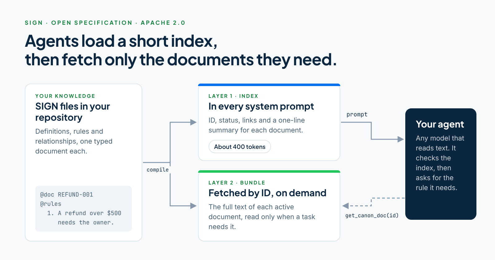

# SIGN — Sigil Intelligence Graph Notation

<picture>
  <source media="(prefers-color-scheme: dark)" srcset="docs/img/sign-readme-hero-dark.png">
  
</picture>

### SIGN is open and free. Charter runs it for your company.

| | SIGN, open source | Charter, from Five Deep |
|---|---|---|
| **What it is** | A file format and open tools, under the Apache License 2.0 | The AI Authority: it delivers your company's knowledge and rules to your agents in SIGN |
| **Writing knowledge** | You write and validate SIGN files. sign-ingest and the Claude Code skills draft them for you to review | Your knowledge lives in Canon, and each area has an owner |
| **Approval** | You set your own review. Everything the tools generate is a draft | Charter requires the area owner's approval. A document the owner adds is approved as it's added. Anyone else's waits for the owner |
| **Getting it to agents** | You compile the index and bundle and wire up `get_canon_doc` yourself | Your agents receive it through MCP |
| **Cost** | Free | Test Drive Charter free for 30 days |

**Start here:** [run the validator on the examples](https://sign-protocol.github.io/sign-lang/engineers/?utm_source=github-sign-lang-readme&utm_medium=referral&utm_campaign=sign-open-source&utm_content=readme-start), about five minutes. Then [Test Drive Charter](https://charter.fivedeep.ai/?utm_source=github-sign-lang-readme&utm_medium=referral&utm_campaign=sign-open-source&utm_content=readme-test-drive).

**Strongly typed · Human readable · Token optimized · For the agentic consumer**

JSON serializes data for machines. SIGN declares knowledge for agents.

[](https://doi.org/10.17605/OSF.IO/6YZJ7)

---

## The Gap SIGN Fills

Every team building production agent systems eventually hits the same wall. How do you give agents access to your domain knowledge, business rules, and governance constraints — at scale, with governance, without burning your token budget — in a form agents can actually reason over rather than just retrieve?

Three partial answers exist today. None of them are complete.

| Existing approach | Why it falls short |
|---|---|
| JSON | Machine-readable but agent-hostile. 50–60% of tokens are structural noise. No relationship semantics. No inference. No constraints. |
| Raw markdown | Token-efficient but structurally untyped. An agent cannot distinguish a rule from a property from a constraint. No relationship model. |
| RDF / OWL | Semantically rigorous but adoption-hostile. Academic syntax, heavy toolchain, near-zero presence in LLM training data. |
| Prompt engineering | Fast but ungoverned. Unversioned, unauditable, non-reusable. Breaks at scale. |

The gap is not a format problem. It is a design-target problem. Every existing approach was designed for a different consumer. None were designed for the LLM agent context window as the primary unit of consumption.

SIGN was.

---

## What SIGN Is

SIGN is the contract layer between a governed knowledge graph and the agents that consume it. It expresses structure, relationships, inference rules, constraints, clusters, and provenance in a form agents can reason over — not just retrieve from.

### What SIGN Expresses

| Layer | What it covers |
|---|---|
| Structure | Entities, taxonomy, definitions, properties, attributes |
| Relationships | Schema-level declarations, instance graph edges, symmetric relationships, crosswalk mappings |
| Clusters | Named typed sets with threshold semantics — capability, co-occurrence, transition, AI impact |
| Inference rules | Governed rules that derive new facts from existing graph state |
| Constraints | Structural rules agents must enforce: mutex, requires, forbids |
| Vocabulary | Governed definitions of every relationship predicate — makes the graph self-describing |
| Provenance | Full derivation chains on every fact — asserted vs inferred, source, validation history |
| Context | Scope-bounded relationships that hold only under specific conditions |
| Governance | Lifecycle status, versioning, review cycles, authority, breaking change signals |

---

## Token Efficiency

The token comparison is real and measurable.

| Metric | SIGN | JSON | Reduction |
|---|---|---|---|
| Full knowledge document | 379 tokens | 978 tokens | 61% |
| 9-document index | 406 tokens | 818 tokens | 50% |

---

## Two-Layer Delivery

SIGN delivers canon in two layers with different injection strategies.

| Layer | Purpose |
|---|---|
| **Layer 1 — Index** | Injected into every agent system prompt. ~400 tokens for a full corpus. Document identity, status, graph edges, one summary line per document. Orientation without rule text. |
| **Layer 2 — Full document** | Retrieved on demand via `get_canon_doc(id)`. Agents only pay for documents they actually need. |

---

## Quick Start

You need Git and Node.js 18 or later. The validator has no dependencies, so there is nothing to install.

### 1 — Clone and validate the examples

```bash
git clone https://github.com/sign-protocol/sign-lang.git
cd sign-lang
node validator/bin/sign.js validate --source examples
```

The last line should read `pass — 11 documents across 6 file(s)`. The `warn` lines before it are expected: the examples link to documents that are not in the folder.

### 2 — Write your own documents and compile them

Put your `.sign` files in a folder, for example `knowledge/`, then:

```bash
node sign-lang/validator/bin/sign.js validate --source knowledge
node sign-lang/validator/bin/sign.js compile --source knowledge --output dist
```

`compile` writes `dist/canon-index.sign` (Layer 1), `dist/canon-bundle.sign` (Layer 2), `dist/canon-manifest.json` and a SHA-256 checksum. Every document you link to must be in the source folder.

### 3 — Give the index to an agent and serve documents by ID

```js
import { readFileSync } from "node:fs";

const index = readFileSync("dist/canon-index.sign", "utf8");
const bundle = readFileSync("dist/canon-bundle.sign", "utf8");

// Split the Layer 2 bundle into documents, keyed by ID.
const docs = new Map();
for (const chunk of bundle.split(/^# --- .+ ---$/m)) {
  const id = chunk.match(/^@doc (\S+)/m)?.[1];
  if (id) docs.set(id, chunk.trim());
}

// Layer 1 goes into every system prompt.
export const systemPrompt = `You work under the following knowledge canon:
${index}
Call get_canon_doc with a document ID when you need its full rules.`;

// Layer 2 is served on demand through a tool.
export function get_canon_doc({ id }) {
  return docs.get(id) ?? `No active document with ID ${id}.`;
}
```

The [engineer guide](https://sign-protocol.github.io/sign-lang/engineers/?utm_source=github-sign-lang-readme&utm_medium=referral&utm_campaign=sign-open-source&utm_content=quick-start-guide) walks through each step with two sample documents and what you should see.

---

## Documentation

- [spec/sign-v1.0.md](spec/sign-v1.0.md) — Complete specification
- [spec/sigil-reference.md](spec/sigil-reference.md) — Quick reference card
- [examples/](examples/) — Worked examples for all major constructs
- [validator/README.md](validator/README.md) — Validator specification for implementors

---

## Status

**v1.0 — April 2026**

Originated at [Career Highways, Inc., dba Five Deep](https://fivedeep.ai/?utm_source=github-sign-lang-readme&utm_medium=referral&utm_campaign=sign-open-source&utm_content=status-line). Open source under the Apache License 2.0.

SIGN is production-validated against a 9-document ontology corpus serving multiple agent workflows.

---

## SIGN in Charter

Charter, from Five Deep, delivers a company's knowledge and rules to its agents in SIGN. Charter requires the area owner's approval. A document the owner adds is approved as it's added. Anyone else's waits for the owner.

[Test Drive Charter](https://charter.fivedeep.ai/?utm_source=github-sign-lang-readme&utm_medium=referral&utm_campaign=sign-open-source&utm_content=test-drive), free for 30 days.

---

## Citation

If you reference SIGN in research or tooling, please cite:

Shepherd, J. & Career Highways (2026). *SIGN: Sigil Intelligence Graph Notation —
The Knowledge Contract Layer for the Agentic Enterprise*.
https://doi.org/10.17605/OSF.IO/6YZJ7

## Contributing

See [CONTRIBUTING.md](CONTRIBUTING.md).

Reserved namespace extensions (`@pathway`, `@signal`, `@benchmark`, `min:/max:`) are tracked in the spec under `@reserved`. Propose new sigils via issue before implementing.
